# Installing OpenSWOS

<!-- The same guide is on the web at https://openswos.net/install/ (packaging/web/site/install):
     change both together. The screenshots are docs/images/setup's, copied beside that page. -->

This guide takes you from nothing to playing, one step at a time. It takes about five
minutes.

**In short:** download OpenSWOS, then run **OpenSWOS Setup** once. It asks where you want to
play, shows you where to get the game, finds what you download, and makes the game's data
from it. For a phone, a handheld or an Amiga it copies the game there too.

- [1. What you need](#1-what-you-need)
- [2. Download](#2-download)
- [3. Install OpenSWOS on your computer](#3-install-openswos-on-your-computer): [Windows](#windows) · [macOS](#macos) · [Linux](#linux)
- [4. Run OpenSWOS Setup](#4-run-openswos-setup): [phone or tablet](#phone-or-tablet) · [handheld](#handheld) · [Amiga](#amiga)
- [4a. World 2026-27 (optional)](#4a-world-2026-27-optional)
- [5. Play](#5-play)
- [If something goes wrong](#if-something-goes-wrong)

---

## 1. What you need

**Your own copy of *Sensible World of Soccer*.** OpenSWOS is a new engine for the game, but
the game's graphics, music, sound and teams are still owned by their makers, so they can't
come with OpenSWOS. The setup makes them from your copy instead.

| Your copy | Where to get it |
|---|---|
| **The PC version** (easiest) | Buy *Sensible World of Soccer 96/97* on [GOG](https://www.gog.com/en/game/sensible_world_of_soccer_9697) and install it. The [PC CD version](https://archive.org/details/msdos_Sensible_World_of_Soccer_96-97_1996) works too. |
| **The Amiga version** | Any of: the two SWOS 96/97 floppies as disk images (`.adf`); a hard disk image with the game on it (`.hdf`, e.g. ASWOS's `swos.hdf`); a WHDLoad install (`.lha`); or a `.zip` of any of these. sensiblesoccer.de's [24/25 season](https://www.sensiblesoccer.de/index.php?&view=newsdetails&id=206) (`swos2425.hdf` or the WHDLoad `.lha`) works too. |

- **For the game on a computer, a phone or a handheld,** one of the two is enough. With both,
  you get the Amiga's music, sound and loading screens as well.
- **For the Amiga version of OpenSWOS,** you need both: the Amiga version for the game's own
  files, the PC version for its AGA pitches and pictures.

You don't have to remember any of this: the setup asks, gives you the links, and finds what
you download.

**You also need a Windows PC, a Mac or a Linux PC to run the setup on,** even if you play on
a phone, a handheld or an Amiga: it makes the game's data there, then copies it over.

Three extras are optional: **World 2026-27** (today's clubs and players, [below](#4a-world-2026-27-optional)),
the **Atari Jaguar** cartridge image (for the Jaguar's players) and a **SWOS 2020** install
(for its pitches).

---

## 2. Download

Get OpenSWOS from **<https://baker76.itch.io/openswos>**. That page and **openswos.net** are
the only official places to get it: OpenSWOS is free, and never asks you to pay or sign up
anywhere else.

First, the game and the setup for the computer you run the setup on:

| Your computer | Download |
|---|---|
| **Windows** (10 or later) | `SWOS-Setup.exe`, the installer |
| **Mac** (Apple silicon or Intel) | `SWOS-macOS-app.zip` |
| **Linux** (PC or Raspberry Pi) | `SWOS-portable.zip`, and `OpenSWOS-Setup.zip` for the setup |

Then, if you play somewhere else as well:

| You play on | Also download |
|---|---|
| **Android** (8.0 or later) | `OpenSWOS-Android.apk`, on the phone |
| **iPhone or iPad** (iOS 15 or later) | `OpenSWOS-iOS.ipa` |
| **A handheld with PortMaster** (R36S, Anbernic, TrimUI, ...) | nothing: the setup has OpenSWOS for PortMaster in it |
| **Amiga** (A1200/A4000 or an emulator) | `OpenSWOS-Setup.zip`: it has the Amiga program in it. Run the setup from there. |

---

## 3. Install OpenSWOS on your computer

### Windows

1. Run **`SWOS-Setup.exe`**.
   - If Windows says *"Windows protected your PC"*, click **More info**, then **Run anyway**.
     OpenSWOS isn't signed by Microsoft, which is why it asks.
2. Click **Next** through the installer.
3. On the last page, leave **"Set up the game data from your copy of Sensible World of
   Soccer"** ticked and click **Finish**. OpenSWOS Setup opens: go to
   [step 4](#4-run-openswos-setup).

Later, you can open the setup again from the Start menu: **OpenSWOS → OpenSWOS Setup**.

### macOS

1. Double-click **`SWOS-macOS-app.zip`**. You get an **OpenSWOS** folder holding
   **SWOS.app** and **OpenSWOS Setup.app**.
2. Drag the **OpenSWOS** folder to **Applications** (or anywhere you like).
3. Open **OpenSWOS Setup.app**. **The first time, right-click it (or Control-click) and
   choose Open**, then **Open** again. OpenSWOS isn't signed by Apple, so a plain
   double-click is refused the first time. Then go to [step 4](#4-run-openswos-setup).

Do the same right-click → **Open** the first time you start **SWOS.app**.

### Linux

1. Unzip **`SWOS-portable.zip`** into a folder of its own, e.g. `~/Games/OpenSWOS`.
2. Unzip **`OpenSWOS-Setup.zip`** anywhere, and run **`Linux/openswos-setup`** from it.
   Go to [step 4](#4-run-openswos-setup).

Which game file to run: **`SWOS.x86_64`** on a normal 64-bit PC, **`SWOS.aarch64`** on a
64-bit Raspberry Pi (Pi 4/5), **`SWOS.armhf`** on a 32-bit Pi. You need a Linux from 2021
or newer (Ubuntu 21.10, Debian 12, Fedora 35 or later).

**For an Amiga,** unzip **`OpenSWOS-Setup.zip`** and run the setup for your computer from it:
`Windows\openswos-setup.exe`, `macOS/OpenSWOS Setup.app` or `Linux/openswos-setup`.

---

## 4. Run OpenSWOS Setup

The setup goes one screen at a time. **Next** goes on, **Back** goes back, **Home** returns to
the first screen, and the dots at the bottom show how far you are. The flag at the top
changes the setup's language (English, Deutsch, Français, Español, Italiano, Nederlands).

**Where do you want to play?** Tick everywhere you'll play: **This computer**, a **Phone or
tablet**, a **Handheld**, an **Amiga** (a SWOS drawer) or an **Amiga with WHDLoad**. Tick the
extras you want too. The screens that follow are only the ones you need.

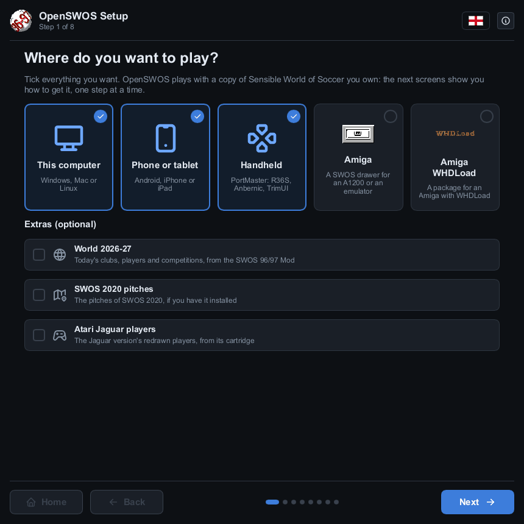

**Which copy of the game do you have?** The PC game, the Amiga version, or both. Not sure?
Pick the PC game: it's the one you can buy today. (For an Amiga you need both, so this screen
is skipped.)

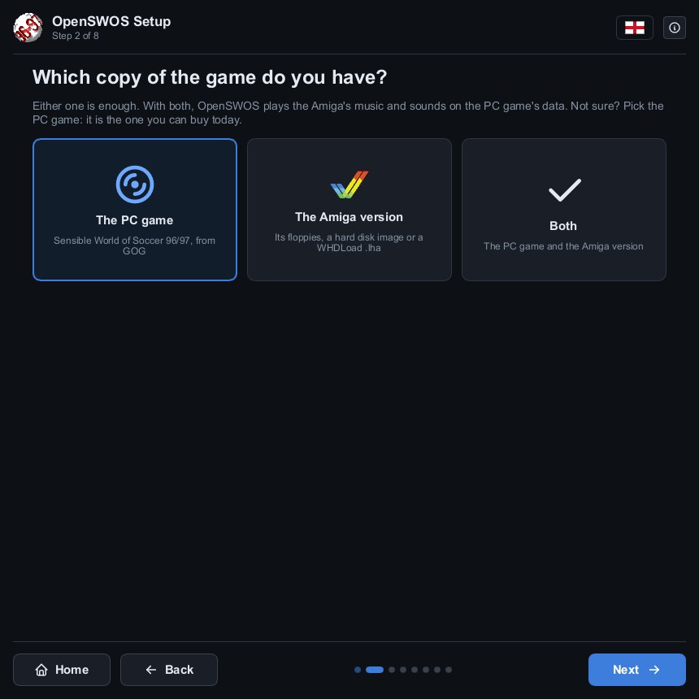

**Get the game.** Each part has a screen with the links to get it. You don't have to look for
the files afterwards:

- **What you download is found by itself.** The setup watches your **Downloads** folder: a
  disk image, hard disk image, WHDLoad `.lha` or `.zip` you download turns up a moment after
  the download finishes.
- **The GOG game is found by itself** once it's installed with GOG's installer or GOG Galaxy.
- **Already have it somewhere?** Drag the file or folder onto the window, or click
  **Search a folder…** and pick a folder it's in: the setup looks through that folder **and
  every folder inside it**. **Choose another…** picks a file or folder by hand. **Start over**
  forgets every copy the setup has found.

When it has it, the screen turns green and says **Found it**:

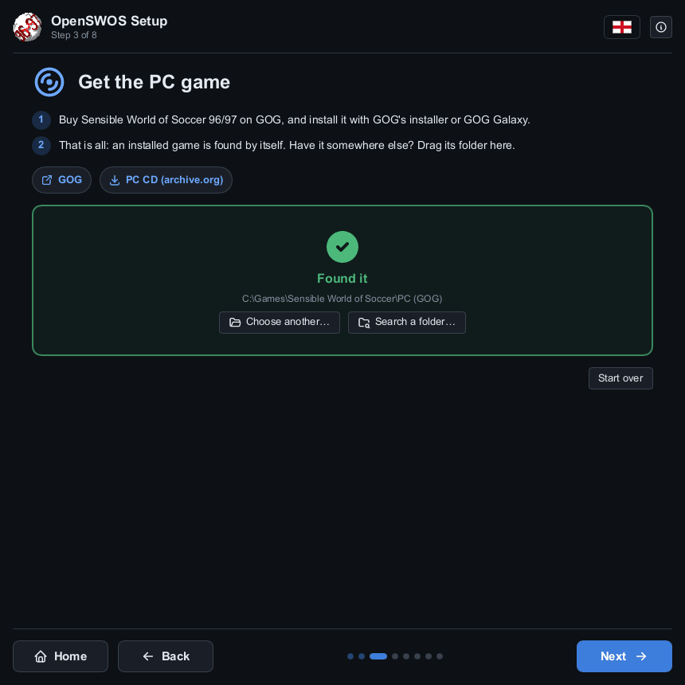

For the Amiga version it also says which **season** your copy is. The 96/97 release is the
one the game was made from; a later season (like sensiblesoccer.de's 24/25) works too, but
online OpenSWOS plays 96/97's teams, so with the PC game those come from it. A copy that
can't be used (a damaged download, or a different release) gets a red mark and says why.

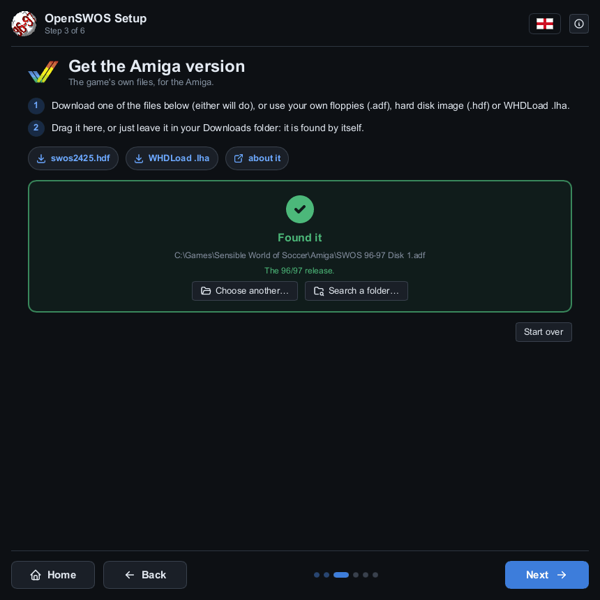

**Game options.** How the game looks and plays the first time you start it: the gameplay,
graphics, sound, music, screen, language and more. Not sure? Leave them: you can change any
of them in the game's **OPTIONS** later.

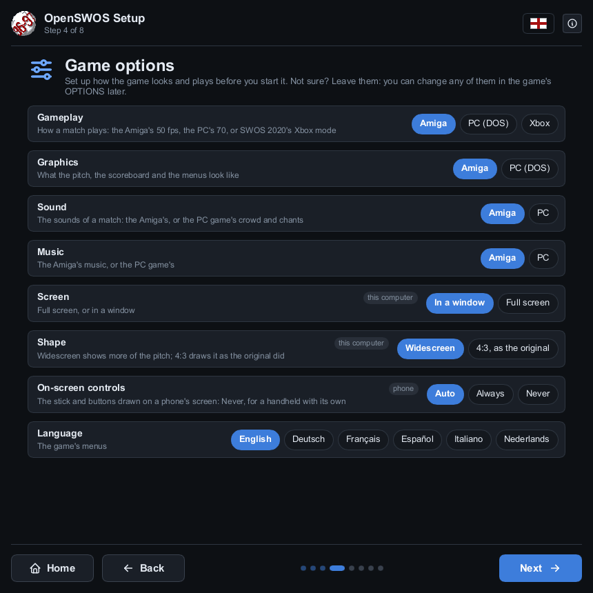

**Install the game's data.** Click **Install**. It takes a few seconds. The folder at the top
is where the game reads its data from: leave it as it is. **Details** below it shows what will
be made (parts you have nothing for are marked *skipped*: the game plays without them) and the
log.

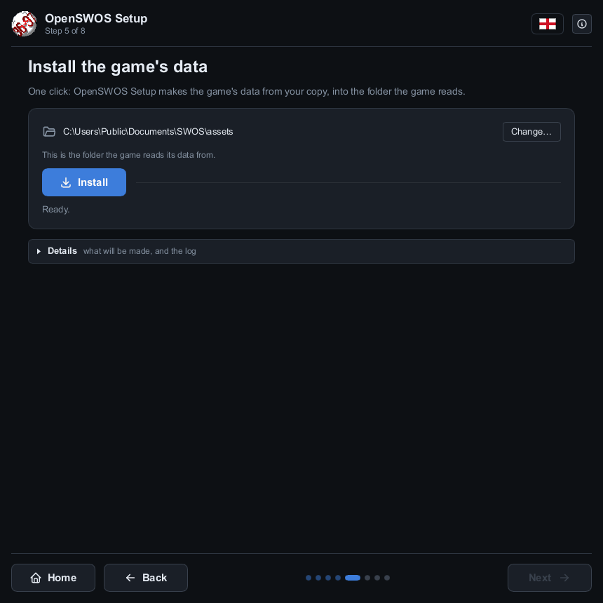

Then, for each other place you ticked:

### Phone or tablet

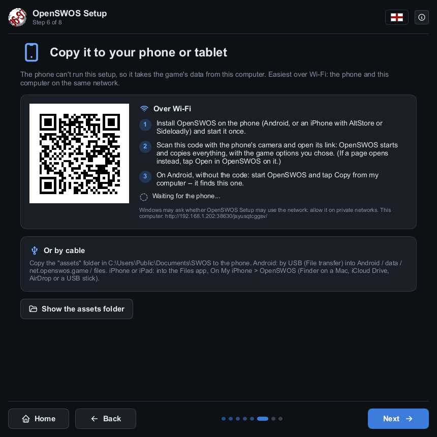

1. **Install the app on the phone.**
   - **Android:** open **`OpenSWOS-Android.apk`** on the phone (download it there, or copy it
     over) and allow installing it when Android asks: it isn't from the Play Store.
   - **iPhone or iPad:** iOS installs apps only from the App Store, so `OpenSWOS-iOS.ipa` goes
     on with a sideloading tool, [AltStore](https://altstore.io) or
     [Sideloadly](https://sideloadly.io), which signs it with your own Apple ID (with a free
     Apple ID it has to be refreshed every 7 days; the tool does that for you).
2. **Start OpenSWOS on the phone once.** It says the game's data comes from OpenSWOS Setup.
3. **Scan the QR code** on the setup's screen with the phone's camera and open its link.
   OpenSWOS starts and copies everything over Wi-Fi, with the game options you chose. If a web
   page opens instead, tap **Open in OpenSWOS** on it. The phone and the computer must be on
   the same network.
   - On Android you can skip the code: tap **Copy from my computer** in OpenSWOS, and it finds
     the setup by itself.
   - Windows may ask whether OpenSWOS Setup may use the network: allow it on private
     networks. An iPhone asks whether OpenSWOS may find devices on your local network: tap
     **OK**.

**Or by cable:** copy the **`assets`** folder (**Show the assets folder** opens it) to the
phone. Android: by USB (File transfer) into `Android/data/net.openswos.game/files`. iPhone or
iPad: into the Files app, **On My iPhone → OpenSWOS** (Finder on a Mac, iCloud Drive, AirDrop
or a USB stick).

### Handheld

For a Linux handheld with [PortMaster](https://portmaster.games) (most firmwares have it:
ArkOS, ROCKNIX, Knulli, AmberELEC, muOS). No PortMaster yet? Install it on the handheld first.

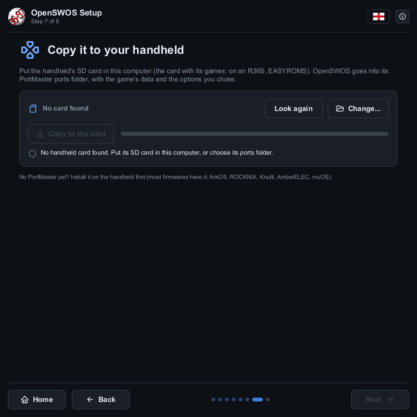

1. Put the handheld's SD card in the computer (on an R36S, the card with its games, EASYROMS).
   The setup finds it; if it doesn't, click **Change…** and pick its **ports** folder.
2. Click **Copy to the card**. OpenSWOS goes into PortMaster's ports folder, with the game's
   data and the options you chose.

The port is also on the downloads page as **`swos.zip`**, for PortMaster on its own.

### Amiga

You need an AGA Amiga with a 68020 or better (an A1200 or A4000, or an emulator set up as
one), with a hard drive, Workbench and 8 MB of fast memory.

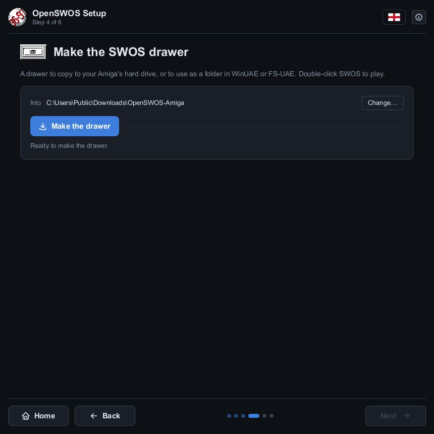

- **SWOS drawer:** click **Make the drawer**. Copy the drawer to your Amiga's hard drive (or
  use it as a folder WinUAE or FS-UAE treats as a hard drive). Double-click **SWOS** in it to
  play.
- **WHDLoad package:** click **Make the package**. You get `OpenSWOSAGA-WHDL.lha`, for an
  Amiga with [WHDLoad](https://whdload.de/) installed. Unpack it on the Amiga, open the
  **OpenSWOSAGA-NE** drawer and double-click **OpenSWOS**. No Kickstart image is needed.

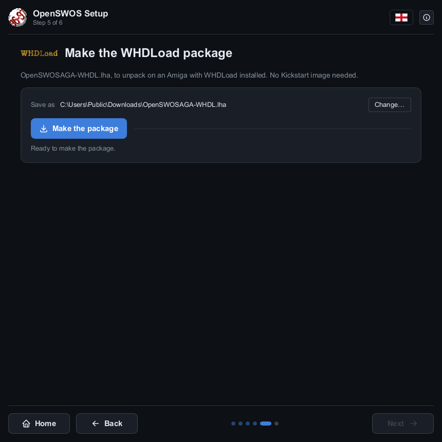

Both go to your **Downloads** folder unless you click **Change…**. If the button stays grey,
the line under it says what's missing: usually the PC version (the Amiga version of OpenSWOS
needs both), or the Amiga program, if you're not running the setup from
`OpenSWOS-Setup.zip`.

**All done.** The last screen says where to start the game. **Play OpenSWOS** starts it on
this computer.

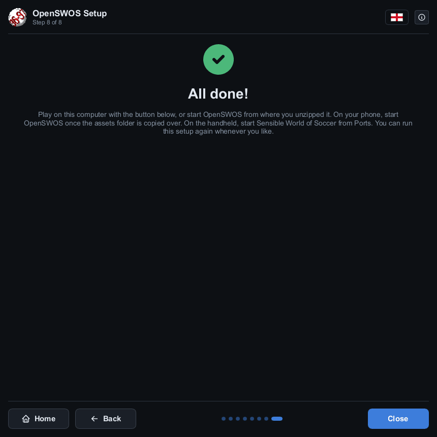

You only need to do this once: OpenSWOS Setup remembers where your copy of the game is. If a
new version of OpenSWOS makes some of the data differently, the game tells you when it
starts: open OpenSWOS Setup, and on its install screen click **Update**.

*(The screenshots are from Windows; the setup looks the same on a Mac and on Linux.)*

---

## 4a. World 2026-27 (optional)

**World 2026-27** is today's football: the clubs, players and competitions of the 2026-27
season, from the [SWOS 96/97 Mod](https://github.com/aminta/swos-9697-mod) by Davide
Lorigliola. It's a download of its own, and the game plays 96/97 unless you ask for it.

1. **Get it.** Tick **World 2026-27** under **Extras** on the setup's first screen. Its screen
   has the link, **OpenSWOS-World-2627.zip**: download it, and the setup finds it by itself
   (or drag it onto the window).
2. **Install it.** It goes in with the rest when you click **Install** (or **Update**).
3. **Turn it on.** In the setup's **Game options**, set **World** to **2026-27**. Or later, in
   the game: **OPTIONS** on the main menu, then **WORLD**. The game plays the new world from
   the next time it starts, so close it and start it again. (It's `world=2627` under
   `[general]` in `SWOS.ini`, if you'd rather set it there.)

   A career or competition you saved is always played in the world it was started in.

- **On an Amiga,** tick **Play World 2026-27 (its clubs and players) instead of 96/97** on the
  drawer's or the package's screen before making it.
- **On a phone or a handheld,** copy the game over again after installing the world (it's in
  the game's data), and choose it in **OPTIONS → WORLD**.
- The world's data is its authors' ([credits](https://worldofswos.com/static/openswos/README.txt)).

---

## 5. Play

- **Windows:** start **OpenSWOS** from the Start menu (or the desktop, if you ticked that
  in the installer).
- **Mac:** open **SWOS.app** (right-click → **Open** the first time).
- **Linux:** run `SWOS.x86_64` (or the one for your Pi) from the folder you unzipped.
- **Android, iPhone and iPad:** tap **OpenSWOS**. The stick (left) and FIRE (right) are on
  the screen, with PAUSE and ESC above FIRE; a Bluetooth controller works too.
- **Handheld:** start **Sensible World of Soccer** from **Ports**.
- **Amiga:** double-click **SWOS** in its drawer, or with WHDLoad, **OpenSWOS** in the
  **OpenSWOSAGA-NE** drawer. Under WHDLoad, **Del** quits back to Workbench.

Menus use the **arrow keys** and **Enter** (or a gamepad). In a match, the arrow keys
move and **Ctrl**, **Space** or **Enter** kick. All the keys and the gamepad buttons are in
[docs/PLAYING.md](docs/PLAYING.md).

**Playing online:** choose **MULTIPLAYER** on the main menu. Both players need the same
version of OpenSWOS.

---

## If something goes wrong

**The setup doesn't find my game.**
Drag it onto the window, or click **Search a folder…** and pick the folder it's in, or
**Choose another…** and pick it by hand:
- *PC game*: the folder with `SPRITE.DAT` and a `DATA` folder in it. GOG puts it where you
  chose when installing, usually under `C:\GOG Games` or under `GOG Galaxy\Games` in
  Program Files.
- *Amiga version*: the `.adf`, `.hdf`, `.lha` or `.zip` file itself. For floppies, add both
  disks: the setup tells them apart by what's on them, not by their names.

**The Amiga version has a red mark.**
It says why. *"…its blocks on the disk are damaged"*: that download is broken, try another
(sensiblesoccer.de's `swos2425.hdf` and WHDLoad `.lha` are both good). *"…is not the 96/97
release or an update of it"*: it's an older SWOS (for example the original 1994 floppies),
which OpenSWOS can't use.

**The phone doesn't copy anything after scanning the code.**
Check the phone and the computer are on the same Wi-Fi (not a guest network), and that
Windows was allowed to let OpenSWOS Setup use private networks. On an iPhone, check
**Settings → OpenSWOS → Local Network** is on. Close OpenSWOS on the phone (swipe it away)
and scan again. Or copy the `assets` folder by cable, as above.

**The handheld card isn't found.**
Click **Look again** once the card is in, or **Change…** and pick the card's `ports` folder
yourself.

**The game won't start, or starts without graphics or sound.**
The game data usually isn't installed. Run OpenSWOS Setup again and check its install screen
says **The game's data is installed**. The game writes what happened to `SWOS.log`, in the
folder below.

**Windows or the Mac won't let me open it.**
OpenSWOS isn't signed. On Windows click **More info → Run anyway**; on a Mac right-click
the app and choose **Open**.

**My gamepad doesn't work.**
See [docs/PLAYING.md](docs/PLAYING.md#gamepad-not-detected).

**Where are my saves and settings?**

| Computer | Folder |
|---|---|
| Windows | `Documents\SWOS` |
| Mac | `~/Library/Application Support/SWOS` (in Finder: **Go → Go to Folder…**) |
| Linux | `~/.swos` |
| Amiga | the `save` folder inside the SWOS drawer (with WHDLoad: `OpenSWOSAGA-NE/data/save`) |

Saves are in `save`, the settings in `SWOS.ini` ([docs/SETTINGS.md](docs/SETTINGS.md)),
the game data from the setup in `assets`. Reinstalling or updating OpenSWOS never touches
them.

**Still stuck, or found a bug?** Please report it on
[github.com/benbaker76/OpenSWOS/issues](https://github.com/benbaker76/OpenSWOS/issues): say which version you have (the bottom
line of the main menu) and what happened, and attach your `SWOS.log`.
